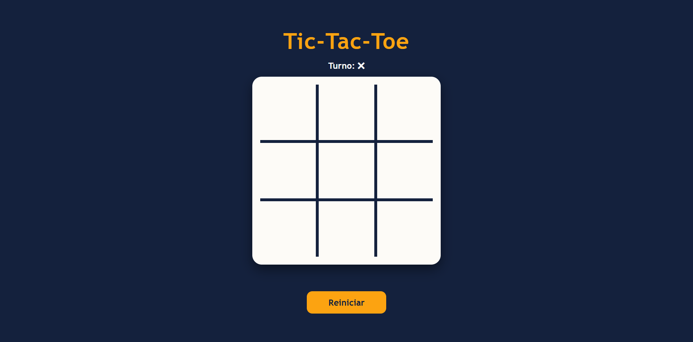
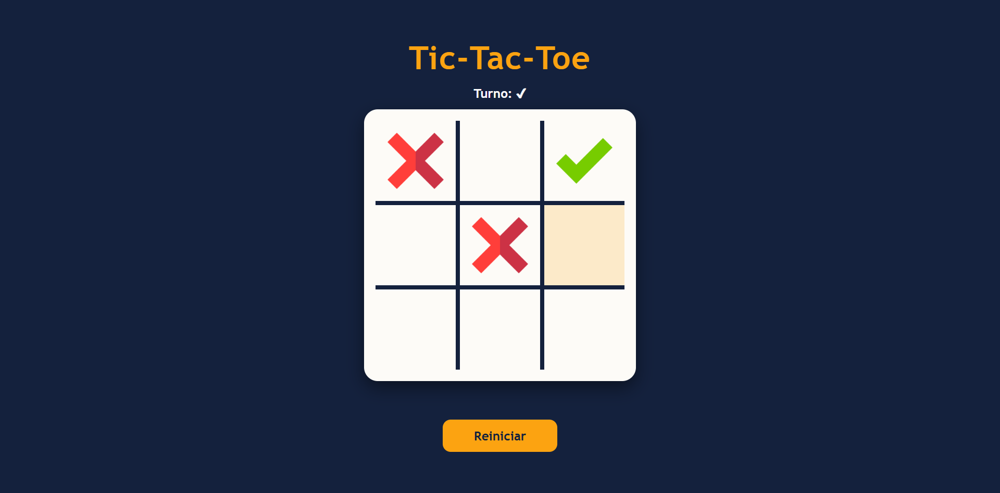
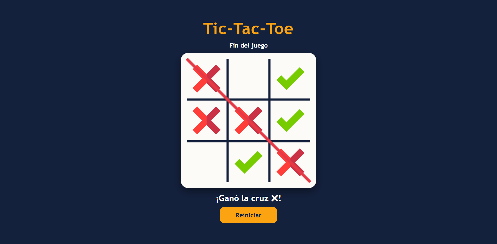
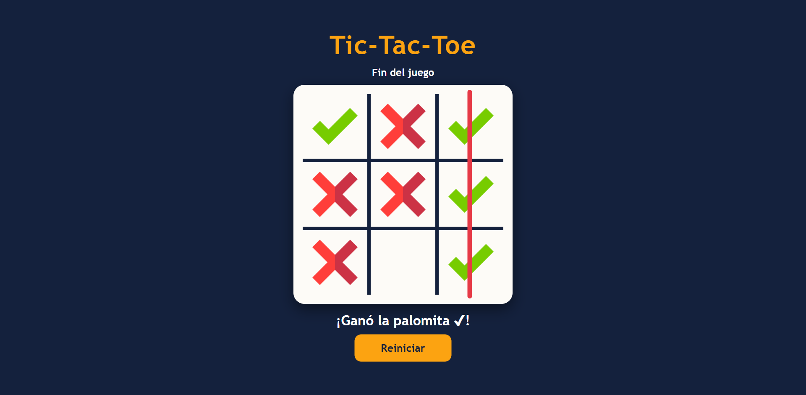
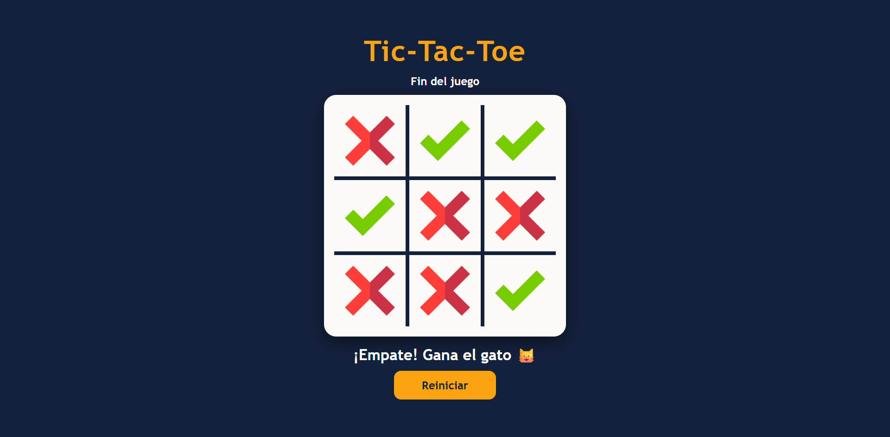
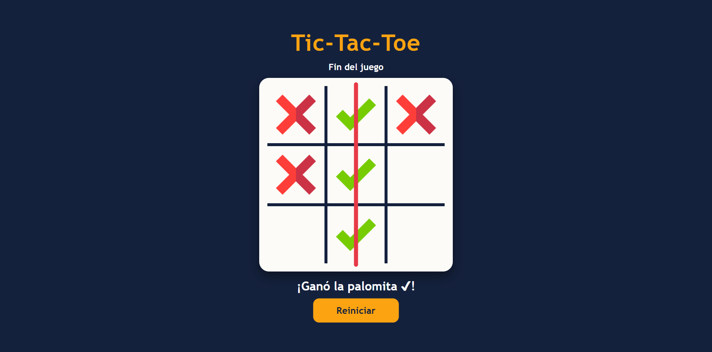

# Tic-Tac-Toe

## Creador

- **[Antuan Carpio]** – GitHub: [@antuancarpio](https://github.com/antuancarpio)

## Descripción

Juego interactivo para el navegador basado en el clásico **tic-tac-toe (juego del gato)** para dos jugadores. En lugar de las tradicionales X y O, se usan una palomita ✔ y una cruz ✖. Gana quien logre alinear tres de sus símbolos en una fila, una columna o una diagonal.

### ¿Cómo se juega?

- **Colocar un símbolo:** haz clic en una casilla libre. Empieza la cruz ✖ y los turnos se alternan.
- **Turno actual:** se muestra arriba del tablero.
- **Victoria:** al alinear tres símbolos se dibuja una línea roja sobre la combinación ganadora y se anuncia al ganador.
- **Empate:** si se llena el tablero sin ganador, aparece el mensaje de empate.
- **Reiniciar:** el botón *Reiniciar* limpia el tablero y empieza una nueva partida.

## Tecnologías

- HTML5
- CSS3
- JavaScript

## Instrucciones de uso

No requiere instalación ni configuración. Solo necesitas un navegador web.

1. Descarga el proyecto o clónalo.
2. Entra a la carpeta del proyecto.
3. Abre el archivo `index.html` en tu navegador (doble clic o arrastrándolo a una ventana del navegador).

## Imágenes

